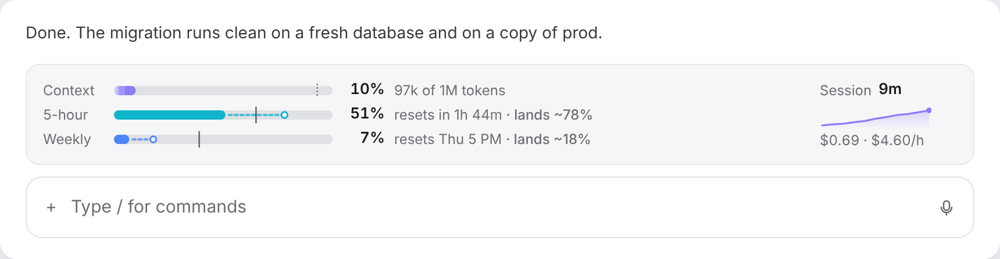
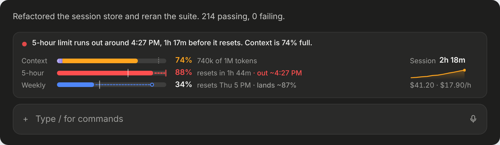

# claude-mods

Mods for [Claude Code](https://claude.com/claude-code) by CloudKoders. A mod is a plugin that changes how Claude Code looks or behaves.

| Mod | What it does |
| --- | --- |
| [hud](#hud) | A compact card above the message box: context, your 5-hour and weekly limits with pace, and session cost |

## Install

Add this repo as a plugin marketplace:

```bash
claude plugin marketplace add cloudkoders/claude-mods
```

Then install the mods you want:

```bash
claude plugin install hud@claude-mods
```

They load right away; if one doesn't show up, run `/reload-plugins` or start a new session. They're built and tested against Claude Code 2.1.316.

To update later:

```bash
claude plugin marketplace update claude-mods
```

```bash
claude plugin update hud@claude-mods
```

## hud



A small card above the message box with one bar per limit your plan reports:

- **Context** is how full the context window is. The bar is split by what's filling it (system prompt, tools, MCP tools, skills, memory, then your conversation), and a dotted line marks where auto-compact starts.
- **5-hour** and **Weekly** are your plan's usage limits. The solid part is what you've used. The small tick is even pace: how much of the window's time has gone by. If the fill is past the tick, you're spending faster than the clock. The dashed tail shows where you'll land when the limit resets if you keep this pace (`lands ~78%`).
- **Session** shows how long the session has run, a sparkline of its cost, and what the last hour of work cost per hour at API prices. Plans like Max don't charge this; it's there as a sense of scale. An idle session drifts down to $0.00/h.

When a limit is on track to run out before it resets, the bar's tail hits a blinking wall, the projection becomes the time you'll run out (`out ~4:27 PM`), and one line appears on top of the card:



Colors stay cool (violet, teal, blue) while you're fine. A bar turns amber at 70%, or when it's projected to reach 95% by reset, and red at 90% or when it will run out before reset. For the first 10% of a window there isn't enough to go on, so the projection stays hidden.

### Three looks

`/hud mode` switches how the card looks on the desktop. Your choice is remembered.

- `/hud mode runway` (the default): one bar per limit, as above.
- `/hud mode orbit`: nested rings, context innermost, with a column of numbers per ring. Hover a ring for its exact figures. A small dot circles the context ring while Claude works, and a ring that will run out glows.
- `/hud mode instrument`: a small dial per limit with the percent in the middle, a triangle on the rim for even pace and a dotted arc for the projection. The session cost sits on a flip counter.

`/hud mode` on its own tells you the current mode. The terminal can't draw rings or dials, so it shows the Runway bars in every mode.

**Starting fresh.** `/hud fresh` asks Claude for a short handoff note (goal, current state, decisions, files, next steps), clears the conversation, and starts the new one with that note, so a long session can get a clean slate without losing the thread. On macOS the note is also copied to your clipboard. Typed while Claude is replying, it waits for the reply to finish. To free up context without starting over, use Claude Code's own `/compact`.

`/hud off` hides the card, `/hud on` shows it again, and `/hud` toggles. The choice is remembered, like the mode.

In the terminal, the bars are drawn with block characters: `█` used, `▒` projected, `│` even pace. The terminal version also shows the model and effort, which the desktop app already shows under the message box.

The card shows in the terminal and in the Claude desktop app, for sessions running on your computer. It doesn't show in cloud sessions (claude.ai/code), on mobile, or in VS Code, because Claude Code doesn't give mods that space there.

**What it reads:** your session's usage figures (the same numbers as `/context`, `/cost` and the status line) and Claude Code's local estimate of what's in the context window. It makes no network calls of its own. `/hud fresh` is the one exception to keep in mind: it asks your current model to write the handoff note, which is a normal model request over your conversation. The only command it runs on your computer is `/usr/bin/pbcopy`, to copy that note. See [`register.tsx`](plugins/hud/hooks/register.tsx).

## Developing

Each mod lives in `plugins/<name>/`. Run a mod's tests and checks with:

```bash
claude plugin test plugins/hud
```

```bash
claude plugin validate plugins/hud
```

Design notes and mocks are in [`docs/`](docs).

hud was inspired by `session-hud` in [angomedia/claude-mods](https://github.com/angomedia/claude-mods).

## License

[MIT](LICENSE)
